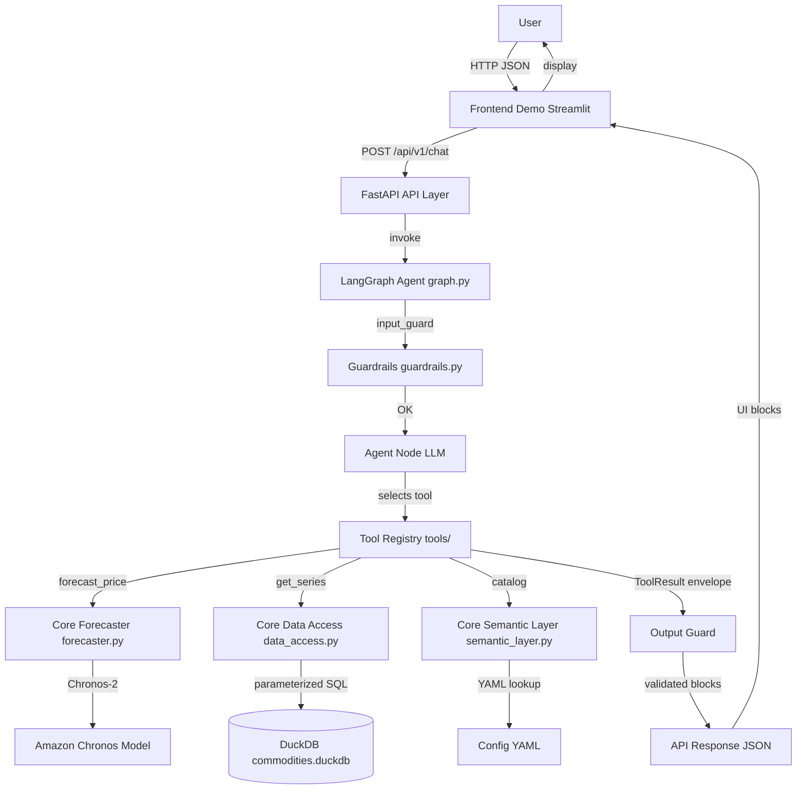

# Backend Explanation (Simplest)

## What it is
Commodity price forecasting agent (onion prices) using AI + data.

## Layers (bottom to top)

1. Data (data/duckdb/) — DuckDB database with raw onion price Excel files.
2. Config (app/config/) — YAML files (semantic_layer.yaml, thresholds.yaml, settings.yaml) define commodities, series, risk thresholds, model settings. Zero hardcoding.
3. Core (app/core/) — Pure Python services:
   - data_access.py: Reads from DuckDB (parameterized SQL only).
   - pipeline.py: Cleans data (fills gaps, removes outliers).
   - semantic_layer.py: Looks up series/commodities from YAML.
   - forecaster.py: Runs Amazon Chronos-2 model for predictions.
   - risk.py: Checks price thresholds and generates alerts.
   - cache.py: Stores temporary results (data_ref, forecast_id).
4. Tools (app/tools/) — Pydantic-validated wrappers (forecast_tool, catalog_tool, series_tool, etc.). The LLM picks these; it never writes SQL or code.
5. Agent (app/agent/) — LangGraph workflow (graph.py):
   - input_guard: Rejects off-topic/abuse.
   - agent: LLM picks a tool.
   - tools: Runs the core service.
   - output_guard: Validates numbers against tool results.
   - assemble: Builds response blocks.
6. API (app/api/) — FastAPI (routes.py) exposes /api/v1/chat, /catalog, /data/{ref}, /forecast/{id}.
7. Main (main.py) — Starts FastAPI, loads singletons (semantic layer, data access, forecaster, agent graph), connects to Groq LLM (or falls back to deterministic offline mode).

## Interaction Flow
User message → FastAPI /chat → LangGraph agent → LLM selects tool → Tool calls core service (e.g., forecaster) → Core reads DuckDB / runs Chronos → Tool returns opaque handle (forecast_id) + summary → Agent assembles UI blocks → API returns JSON blocks.

Frontend (frontend_demo/app.py) is just Streamlit calling the API; backend has zero Streamlit imports.

## Architecture & Execution Flow Diagram

